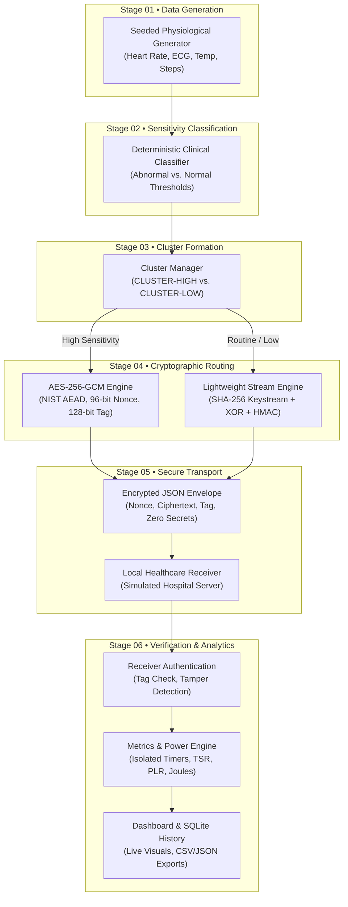

# ClusterGuard • Cluster-Based IoT Healthcare Data Encryption & Energy Lab

[](https://www.python.org/)
[](https://fastapi.tiangolo.com/)
[]()
[]()

> **An academic research prototype, benchmarking engine, and interactive simulation dashboard evaluating Sensitivity-Adaptive Cryptographic Routing for battery-constrained IoT healthcare sensor nodes.**

---

## Table of Contents
1. [Executive Summary & Core Concept](#1-executive-summary--core-concept)
2. [The IoT Healthcare Security & Energy Problem](#2-the-iot-healthcare-security--energy-problem)
3. [System Architecture & Pipeline](#3-system-architecture--pipeline)
4. [Dual Hardware Evaluation Scenarios (Desktop vs. Target MCU)](#4-dual-hardware-evaluation-scenarios)
5. [Security Engineering & Cryptographic Disclosures](#5-security-engineering--cryptographic-disclosures)
6. [Repository & Codebase Structure](#6-repository--codebase-structure)
7. [Installation & Quickstart Guide](#7-installation--quickstart-guide)
8. [Dashboard Walkthrough & Faculty Review Guide](#8-dashboard-walkthrough--faculty-review-guide)
9. [Automated Verification & Test Suite](#9-automated-verification--test-suite)
10. [Defense Presentation Script & Review Panel FAQ](#10-defense-presentation-script--review-panel-faq)

---

## 1. Executive Summary & Core Concept

Continuous wearable health monitors (e.g., electrocardiograms, pulse oximeters, body thermometers, and ambulatory monitors) collect non-stop patient vitals. In clinical IoT environments, applying uniform heavy cryptographic algorithms (such as NIST AES-256-GCM) to **every routine telemetry packet** severely depletes the limited battery capacity of microcontrollers.

**ClusterGuard** explores an adaptive alternative:
- **Baseline Mode (Uniform Security):** Encrypts 100% of telemetry packets with authenticated AES-256-GCM.
- **Proposed Adaptive Mode (Sensitivity Routing):** Partitions telemetry by clinical severity:
  - **High-Sensitivity / Diagnostic Data:** Abnormal vitals (arrhythmias, extreme temperatures, hypertension alarms) route through **AES-256-GCM** with fresh 96-bit nonces.
  - **Routine / Low-Sensitivity Data:** Normal baseline telemetry and step counts route through an **experimental lightweight stream cipher** (keystream expansion + bitwise XOR + HMAC-SHA-256 authentication).

### Key Scientific Findings & Academic Honesty
1. **On Host Workstations (x86-64 Desktop):** The adaptive route produces a **computational regression (+125% to +336% latency increase)** because modern desktop CPUs feature **silicon-level AES-NI acceleration** via OpenSSL in native C, whereas the experimental XOR/HMAC cipher runs in interpreted Python bytecode. The dashboard honestly reports `STATUS: REGRESSION` and clearly states that desktop software models do not represent bare-metal silicon.
2. **On Target Edge Microcontrollers (Simulated ARM Cortex-M0+ / ATmega):** Where hardware AES-NI instructions are absent, software-only AES-256 requires ~20,000 CPU clock cycles (~1.25 ms), while the lightweight XOR route requires ~10,000 cycles (~0.64 ms). Depending on radio airtime, the model predicts **~12.9% batch energy savings** for short-transmission radios and **~6.6% savings** for standard IoT radios where transmission power dominates.
3. **Epistemic Honesty:** All energy figures clearly distinguish **Empirical Hardware Benchmarks**, **Physical Instrument CSV Imports**, and **Simulated Mathematical Models**. No artificial savings are claimed on desktop hardware.

---

## 2. The IoT Healthcare Security & Energy Problem

```
┌────────────────────────────────────────────────────────────────────────┐
│                        THE WEARABLE TRADEOFF                           │
├────────────────────────────────────────────────────────────────────────┤
│  Wearable Medical Sensor Node (e.g., ECG Holter / Smart Patch)         │
│  • Microcontroller: 16 MHz 32-bit Cortex-M0+ or 8-bit AVR              │
│  • Battery: 1200 mAh Li-Po Cell                                        │
│  • Radio: BLE / IEEE 802.15.4 Transceiver (28 mA active TX)            │
├───────────────────────────────────┬────────────────────────────────────┤
│   UNIFORM ENCRYPTION (BASELINE)   │  SENSITIVITY-ADAPTIVE (PROPOSAL)   │
│   • 100% AES-256-GCM              │   • Critical vitals: AES-256-GCM   │
│   • Heavy CPU cycles per packet   │   • Routine vitals: Lightweight    │
│   • Battery depletes rapidly      │   • Saves CPU cycles & energy      │
│   • Uniform security overkill     │   • Preserves diagnostic security  │
└───────────────────────────────────┴────────────────────────────────────┘
```

Wearable medical sensor nodes face three conflicting engineering constraints:
1. **Battery Life:** Frequent battery replacements compromise continuous physiological monitoring and patient adherence.
2. **Privacy & Regulatory Compliance:** HIPAA, GDPR, and medical device standards mandate authenticated encryption for protected health information (PHI).
3. **Resource Scarcity:** Edge microcontrollers operate at low clock frequencies (e.g., 16 MHz) with limited RAM (e.g., 2 KB to 32 KB) and lack dedicated cryptographic hardware accelerators.

---

## 3. System Architecture & Pipeline

The system implements an end-to-end 6-stage telemetry processing pipeline:



### Stage Details

1. **Synthetic Data Generation (`src/data_generator.py`):**
   - Generates physiologically plausible cardiac, thermal, and activity records.
   - Deterministic pseudorandom generation using configurable seeds ensures byte-level reproducibility.
2. **Clinical Sensitivity Classification (`src/classifier.py`):**
   - Applies deterministic rules to assign `HIGH` or `LOW` sensitivity:
     - **HIGH:** Heart Rate $> 100$ bpm (tachycardia) or $< 50$ bpm (bradycardia); Body Temp $\ge 38.0^\circ\text{C}$ or $\le 35.5^\circ\text{C}$; ECG waveform summaries indicating arrhythmias.
     - **LOW:** Normal resting vitals and step telemetry.
   - Every classification includes a plain-language clinical justification string.
3. **Cluster Formation (`src/cluster_manager.py`):**
   - Deterministically groups batch records into `CLUSTER-HIGH` and `CLUSTER-LOW`.
4. **Cryptographic Routing (`src/crypto.py`):**
   - **High-Risk Path:** Standard AES-256-GCM with cryptographically random 96-bit nonces (`secrets.token_bytes(12)`) and 128-bit authentication tags.
   - **Routine Path:** Experimental keystream generator (SHA-256 PRNG) + bitwise XOR + HMAC-SHA-256 authentication tag for message integrity.
5. **Secure Envelope Transport & Receiver Ingestion (`src/receiver.py`, `src/server.py`):**
   - Packages payloads into canonical JSON envelopes without leaking plaintext or keys.
   - Simulates wireless ingestion at a local clinical endpoint.
6. **Integrity Verification & Metrics Isolation (`src/metrics.py`, `src/benchmark_runner.py`):**
   - Receiver verifies authentication tags before accepting data into electronic health records.
   - High-resolution monotonic timers (`time.perf_counter_ns`) measure pure crypto duration isolated from JSON serialization and network delay.

---

## 4. Dual Hardware Evaluation Scenarios

The platform evaluates cryptographic performance under two distinct hardware paradigms:

### Scenario A: Current Host Workstation (x86-64 Desktop Benchmark)
- **Environment:** Multi-core Intel/AMD processor with hardware **AES-NI** silicon acceleration.
- **Outcome:** **REGRESSION**. AES-256-GCM executes in ~0.010 ms/record via OpenSSL native C assembly. In contrast, the experimental Python XOR and HMAC loop executes in ~0.035 ms/record due to interpreter bytecode overhead.
- **UI Presentation:** Displays `STATUS: REGRESSION`, red warning banners, and `SOFTWARE-MODEL ESTIMATE — NOT A PHYSICAL BATTERY READING`.

### Scenario B: Constrained IoT Microcontroller (Simulated Target MCU)
- **Environment:** 16 MHz 32-bit ARM Cortex-M0+ or 8-bit AVR microcontroller operating at 3.3V supply without cryptographic coprocessors.
- **Model Assumptions:** Non-overlapping execution intervals:
  $$\text{Total Duration} = t_{\text{shared\_proc}} + t_{\text{crypto}} + t_{\text{radio\_tx}} + t_{\text{idle}}$$
  $$\text{Total Energy} = V_{cc} \sum (I_k \times t_k)$$
- **Execution & Current Parameters:**
  - Base CPU Active: 8.5 mA ($t_{\text{proc}} = 0.30\text{ ms}$)
  - Software AES-256-GCM: 9.8 mA ($t_{\text{aes}} = 1.25\text{ ms}$, ~20,000 cycles)
  - SHA-256 Keystream: 8.2 mA ($t_{\text{sha}} = 0.25\text{ ms}$, ~4,000 cycles)
  - Bitwise XOR: 7.5 mA ($t_{\text{xor}} = 0.01\text{ ms}$, ~160 cycles)
  - HMAC-SHA-256: 8.4 mA ($t_{\text{hmac}} = 0.38\text{ ms}$, ~6,080 cycles)
  - Radio TX: 28.0 mA ($t_{\text{tx}} = 0.50\text{ ms}$ or $1.50\text{ ms}$)
  - Deep Sleep: 5.0 µA ($t_{\text{idle}}$ over 20 ms duty-cycle period @ 50 Hz reporting)

#### Named MCU Profiles
| Profile Name | Radio TX Airtime ($t_{\text{tx}}$) | Predicted Batch Energy Saving | Dominant Energy Factor |
|---|---|---|---|
| **Compute-Intensive / Short-TX** | **0.50 ms** (BLE 2Mbps) | **~12.91%** | Cryptographic efficiency (31% crypto reduction) |
| **Radio-Heavy MCU Model** | **1.50 ms** (802.15.4 / low-baud) | **~6.63%** | Radio transmission dominates (~73% of budget) |
| **Custom MCU Configuration** | Configurable via Drawer | Dynamically calculated | User-defined parameters |

---

## 5. Security Engineering & Cryptographic Disclosures

### AES-256-GCM Guarantees
- Industry-standard authenticated encryption with associated data (AEAD).
- Confidentiality via AES in Counter (CTR) mode; integrity via Galois/Counter Model (GCM) GHASH.
- Guarantees complete defense against chosen-ciphertext attacks (IND-CCA2).
- Fresh 96-bit nonces generated for every record; nonce tracking prevents replay and reuse.

### Academic Comparison Boundary: XOR Disclosures
> [!WARNING]
> **Experimental Baseline Notice:**
> Bitwise XOR alone does **not** provide production-grade confidentiality for healthcare records. If a keystream is reused or predictable, plaintext recovery attacks (such as many-time pad cryptanalysis) are trivial.
> In ClusterGuard, the XOR route is implemented strictly as an **algorithmic lower-bound baseline** to evaluate the theoretical CPU savings proposed in academic literature. The attached HMAC-SHA-256 provides data integrity only; it does not resolve XOR's inherent confidentiality limitations. Production healthcare devices must utilize authenticated AEAD ciphers (e.g., AES-256-GCM or ChaCha20-Poly1305).

### Interactive Tamper Rejection
The platform provides a live bit-flip injection utility:
- Mutates ciphertext, nonce, or authentication tag bytes prior to transmission.
- Demonstrates immediate receiver rejection (`tampering detected`) for both AES-GCM and XOR+HMAC paths.

### Zero Secret Leakage Policy
- All cryptographic keys are ephemeral development keys stored in volatile memory or loaded via environment variables (`IOT_AES_KEY_HEX`, `IOT_XOR_KEY_HEX`, `IOT_HMAC_KEY_HEX`).
- The `KeyManager` class automatically redacts key bytes in `__repr__` and `__str__`.
- Automated security audit tests (`test_zero_secret_leakage_audit`) verify that zero secret keys are ever logged to disk, stored in SQLite, or exported in CSV/JSON downloads.

---

## 6. Repository & Codebase Structure

```
c:\Cluster based IoT data encryption\
├── src/                               # Backend Application Logic
│   ├── server.py                      # FastAPI REST application & endpoint handlers
│   ├── models.py                      # Pydantic schemas, enums, and data models
│   ├── data_generator.py              # Seeded synthetic physiological record generator
│   ├── classifier.py                  # Deterministic clinical sensitivity classifier
│   ├── cluster_manager.py             # Batch grouping and cluster partitioner
│   ├── crypto.py                      # AES-256-GCM, XOR stream cipher, and key manager
│   ├── receiver.py                    # Clinical ingestion endpoint & integrity verifier
│   ├── metrics.py                     # Monotonic latency, TSR, PLR, and energy integration
│   ├── power_measurement.py           # McuEnergyModel, hardware adapter, CSV importer
│   ├── benchmark_runner.py            # Paired comparison runner (warmup + 10 repetitions)
│   └── run_store.py                   # SQLite persistence for runs, records, and exports
│
├── static/                            # Frontend Single-Page Application (SPA)
│   ├── index.html                     # Semantic HTML5 dashboard layout
│   ├── app.js                         # State management, animations, charts, and API client
│   └── styles.css                     # Premium dark-mode design system & responsive CSS
│
├── tests/                             # Automated Test Suite (63 Tests, 100% Pass)
│   ├── test_phase1_pipeline.py        # Generator, rules, clustering
│   ├── test_phase2_crypto_receiver.py # AES/XOR roundtrip, tamper rejection, nonces
│   ├── test_phase3_benchmark_engine.py# Timing isolation, paired trials, cancellation
│   ├── test_phase4_battery_subsystem.py# Trapezoidal integration, CSV parser, fallback
│   ├── test_phase5_api_and_exports.py # Health, benchmark endpoints, CSV/JSON exports
│   ├── test_phase6_hardening.py       # Zero key leakage, corrupt packets, SQLite reload
│   ├── test_phase8_audit_and_validation.py # Multi-rep stats, formulas, timing isolation
│   └── test_battery_scenarios.py      # Dual scenario verification, 422 validation, duty cycle
│
├── scripts/                           # Headless Utilities & Browser Tests
│   ├── run_demo_benchmark.py          # Command-line paired benchmark execution
│   ├── test_battery_scenarios_browser.py # Playwright automated battery test suite
│   ├── test_browser_e2e.py            # Full Playwright end-to-end browser verification
│   └── profile_crypto.py              # Low-level CPU timing profiling script
│
├── docs/                              # Comprehensive Research & Presentation Guides
│   ├── DEMO_SCRIPT_AND_PANEL_FAQ.md   # 5-minute presentation script & defense FAQ
│   ├── BATTERY_METHODOLOGY.md         # Energy accounting & duty cycle methodology
│   ├── PERFORMANCE_AUDIT_AND_REGRESSION_ANALYSIS.md # x86 vs. MCU performance audit
│   └── UI_REDESIGN_AND_DEMO_WALKTHROUGH.md # Visual dashboard walkthrough
│
├── data/                              # Local runtime data (ignored in git)
├── exports/                           # Exported benchmark CSV and JSON evidence files
├── requirements.txt                   # Production and testing dependencies
└── README.md                          # Comprehensive project documentation (this file)
```

---

## 7. Installation & Quickstart Guide

### Prerequisites
- **Operating System:** Windows, macOS, or Linux.
- **Python:** Version 3.10 or higher (Tested on Python 3.14.5).
- **Browser:** Any modern web browser (Edge, Chrome, Firefox, Safari).

### 1. Clone & Set Up Environment
```bash
# Clone the repository
git clone https://github.com/JATIN17082005/Cluster-Based-IoT-Healthcare-Encryption.git
cd Cluster-Based-IoT-Healthcare-Encryption

# Create and activate a virtual environment (optional but recommended)
python -m venv venv
# Windows:
.\venv\Scripts\activate
# Linux/macOS:
source venv/bin/activate

# Install dependencies
pip install -r requirements.txt
```

### 2. Start the Application Server
```bash
python -m uvicorn src.server:app --port 8000 --host 127.0.0.1
```
The server starts locally at `http://127.0.0.1:8000`.

### 3. Open the Dashboard
Open your web browser and navigate to:
```
http://127.0.0.1:8000
```

### 4. Run Headless Demo Benchmark (Optional)
To execute an automated paired comparison and generate sample exports from the terminal:
```bash
python scripts/run_demo_benchmark.py
```
Outputs are written to `exports/sample_benchmark_run.csv` and `exports/sample_benchmark_comparison.json`.

---

## 8. Dashboard Walkthrough & Faculty Review Guide

The dashboard is structured into five accessible tabs designed to communicate the research findings within 10 seconds:

```
┌────────────────────────────────────────────────────────────────────────┐
│                        CLUSTERGUARD DASHBOARD                          │
├───────────────┬────────────────────────────────────────────────────────┤
│ Header Strip  │ Backend Health • Dev Keys • Epistemic Provenance Badge │
├───────────────┴────────────────────────────────────────────────────────┤
│  [Tab 1: Overview & Live Demo]                                         │
│  • 4 Dynamic KPI Cards (Records, High/Low Split, Mean Latency, Energy) │
│  • Interactive 6-Stage Pipeline Inspector (Clickable Stage Drawers)    │
│  • Seeded Workload Generator & Paired Benchmark Execution              │
│  • Live Security Tamper Rejection Demo (Bit-Flip Injection)            │
├────────────────────────────────────────────────────────────────────────┤
│  [Tab 2: Comparison & Battery Lab]                                    │
│  • Hardware Scenario Selector (Desktop vs. Target MCU Simulation)      │
│  • Dual Animated SVG Battery Meters with Left-to-Right Drain           │
│  • Simulation Controls (Start, Pause, Resume, Reset, Replay)           │
│  • Presentation Scale Selector (80% High-Contrast, 50%, 20%, 1x)       │
│  • 4 Horizontal Cards (Crypto Time, CPU Cycles, Crypto Energy, Total)  │
│  • Sub-Panel C: Component Energy Breakdown (AES, SHA, XOR, HMAC)       │
│  • Sub-Panel D: Non-Overlapping Whole-Batch Energy Accounting          │
│  • Sub-Panel E: Radio Airtime Sensitivity Sweep (0.50 ms – 1.50 ms)    │
│  • Sub-Panel F: Target-MCU Energy Model Assumptions & Provenance Table │
├────────────────────────────────────────────────────────────────────────┤
│  [Tab 3: Record Explorer]                                              │
│  • Real-time searchable telemetry record table                         │
│  • Sensitivity filter buttons (All, High Only, Routine Only)           │
│  • Slide-out Record Inspection Drawer with Hex Ciphertext and Nonces   │
├────────────────────────────────────────────────────────────────────────┤
│  [Tab 4: Security & Hardware Setup]                                    │
│  • Power Model Configuration (Voltage, Active Currents, Sleep State)   │
│  • Calibrated External Lab Power CSV Importer (Monsoon / Keysight logs)│
│  • Cryptographic Key Status (Ephemeral in-memory development keys)     │
├────────────────────────────────────────────────────────────────────────┤
│  [Tab 5: Run History & Evidence Exports]                               │
│  • Persistent SQLite Historical Run Log                                │
│  • Side-by-side run comparative delta viewer                           │
│  • One-click export to CSV and JSON formats                            │
└────────────────────────────────────────────────────────────────────────┘
```

---

## 9. Automated Verification & Test Suite

The repository includes a comprehensive automated test suite consisting of **63 test cases** covering every functional requirement, mathematical calculation, edge case, and boundary condition.

### Running Pytest
```bash
python -m pytest tests/ -v
```

```text
============================= test session starts =============================
collected 63 items

tests/test_battery_scenarios.py (18 Tests)
  ✓ test_mcu_energy_model_non_overlapping_intervals       PASSED
  ✓ test_mcu_energy_savings_derived_from_model            PASSED
  ✓ test_benchmark_runner_desktop_non_overlapping         PASSED
  ✓ test_presentation_scale_does_not_change_energy        PASSED
  ✓ test_mcu_scenario_api_endpoints                       PASSED
  ✓ test_scenarios_remain_strictly_separated              PASSED
  ✓ test_custom_mcu_parameters_improvement_and_regression PASSED
  ✓ test_crypto_cycles_and_isolated_component_breakdown   PASSED
  ✓ test_mcu_sensitivity_tuning_query_params              PASSED
  ✓ test_proportional_visual_battery_scaling              PASSED
  ✓ test_mcu_profiles_short_tx_vs_radio_heavy             PASSED
  ✓ test_radio_sensitivity_sweep_across_intervals         PASSED
  ✓ test_high_contrast_visual_battery_scaling_80_percent  PASSED
  ✓ test_mcu_workload_split_validation_422                PASSED
  ✓ test_custom_mcu_profile_identification               PASSED
  ✓ test_duty_cycle_metadata_accounting                   PASSED
  ✓ test_seed_consistency_between_generation_and_benchmark PASSED
  ✓ test_safe_localhost_cors_headers                     PASSED

tests/test_phase1_pipeline.py (4 Tests)
  ✓ test_generator_reproducibility                        PASSED
  ✓ test_generator_different_seeds                        PASSED
  ✓ test_classification_rules                            PASSED
  ✓ test_cluster_formation                               PASSED

tests/test_phase2_crypto_receiver.py (7 Tests)
  ✓ test_key_manager_redaction                            PASSED
  ✓ test_aes256_gcm_roundtrip                             PASSED
  ✓ test_xor_roundtrip                                    PASSED
  ✓ test_aes_tamper_rejection                             PASSED
  ✓ test_xor_tamper_rejection                             PASSED
  ✓ test_nonce_uniqueness                                 PASSED
  ✓ test_receiver_stats_tracking                          PASSED

tests/test_phase3_benchmark_engine.py (5 Tests)
  ✓ test_tsr_and_plr_formulas                             PASSED
  ✓ test_timing_stats                                     PASSED
  ✓ test_percentage_change_directions                     PASSED
  ✓ test_paired_benchmark_execution                       PASSED
  ✓ test_benchmark_cancellation                           PASSED

tests/test_phase4_battery_subsystem.py (8 Tests)
  ✓ test_unit_conversions                                 PASSED
  ✓ test_energy_integration_known_signal                  PASSED
  ✓ test_indicative_battery_runtime                       PASSED
  ✓ test_csv_importer_valid                               PASSED
  ✓ test_csv_importer_valid_alternate_headers            PASSED
  ✓ test_csv_importer_rejections                          PASSED
  ✓ test_simulation_fallback_provenance                   PASSED
  ✓ test_hardware_adapter_unconnected                    PASSED

tests/test_phase5_api_and_exports.py (7 Tests)
  ✓ test_health_endpoint                                  PASSED
  ✓ test_demo_generate_endpoint                           PASSED
  ✓ test_benchmark_run_and_comparison_endpoints           PASSED
  ✓ test_tamper_demo_endpoint                             PASSED
  ✓ test_power_csv_import_endpoint                        PASSED
  ✓ test_export_endpoints                                 PASSED
  ✓ test_index_html_serving                               PASSED

tests/test_phase6_hardening.py (5 Tests)
  ✓ test_sqlite_persistence_across_reloads                PASSED
  ✓ test_zero_secret_leakage_audit                        PASSED
  ✓ test_corrupt_envelope_handling                        PASSED
  ✓ test_repeated_comparison_reproducibility              PASSED
  ✓ test_source_label_honesty                             PASSED

tests/test_phase8_audit_and_validation.py (9 Tests)
  ✓ test_percentage_change_and_energy_saving_formulas     PASSED
  ✓ test_evaluate_result_status_classification            PASSED
  ✓ test_multi_repetition_aggregate_statistics            PASSED
  ✓ test_unrounded_mathematical_consistency               PASSED
  ✓ test_warmup_and_ten_measured_repetitions              PASSED
  ✓ test_timing_isolation_and_breakdown                   PASSED
  ✓ test_mode_b_physical_power_integration                PASSED
  ✓ test_security_audit_key_sizes_nonces_and_tampering    PASSED
  ✓ test_full_pipeline_api_and_export_consistency         PASSED

======================== 63 passed in 1.36s ========================
```

### Running Browser E2E Tests (Playwright)
```bash
# Verify battery simulation, controls, and dual profiles
python scripts/test_battery_scenarios_browser.py

# Verify full dashboard tabs, drawer interactions, and exports
python scripts/test_browser_e2e.py
```

---

## 10. Defense Presentation Script & Review Panel FAQ

### 5-Minute Live Presentation Script

#### 1. Problem Statement (1 Minute)
> "Good morning, professors. Wearable medical devices—such as battery-powered ECG monitors—produce non-stop vitals data under strict energy constraints. Conventional systems apply heavy AES-256 encryption uniformly to every packet, which rapidly drains battery life on edge microcontrollers.
> In this project, we evaluated **Cluster-Based Sensitivity-Adaptive Cryptographic Routing**, partitioning telemetry so that critical diagnostic data uses NIST AES-256-GCM, while routine telemetry routes through an experimental lightweight stream path."

#### 2. Live Pipeline Demonstration (1.5 Minutes)
> "On **Tab 1**, our deterministic generator produces 50 physiological records. The classifier categorizes abnormal vitals—such as arrhythmias or fever spikes—as **HIGH** sensitivity, while normal resting telemetry is categorized as **LOW**.
> When we click **'Run Both / Compare'**, the engine executes a paired benchmark. High-sensitivity records use AES-256-GCM with fresh 96-bit nonces, while routine records route to the lightweight stream engine. Both batches are transmitted to our simulated clinical receiver, which validates authentication tags."

#### 3. Honest Performance Analysis (1.5 Minutes)
> "When evaluating performance on this laptop:
> - On our **Desktop Host (Scenario A)**, the adaptive proposal exhibits a **REGRESSION**. Why? Because modern desktop CPUs feature hardware **AES-NI instructions** that execute AES in silicon at native CPU speed via OpenSSL. In contrast, Python-interpreted XOR/HMAC loops incur interpreter overhead. Our dashboard honestly reports `STATUS: REGRESSION`.
> - On **Tab 2 (Battery Lab)**, we switch to **Scenario B: Constrained IoT Microcontroller**. In an edge environment lacking AES-NI, software AES requires ~20,000 cycles, while the lightweight route requires ~10,000 cycles.
> - With a short radio airtime (0.5 ms), cryptographic efficiency yields **~12.9% batch energy savings**. In a standard radio-heavy environment (1.5 ms), radio transmission dominates 73% of the budget, yielding **~6.6% savings**."

#### 4. Security Verification & Conclusion (1 Minute)
> "To verify integrity, our **Interactive Tamper Rejection** control injects bit-flips into the ciphertext. The receiver immediately detects the authentication tag mismatch and drops the corrupted packet, preventing corrupted medical data from polluting hospital records.
> In conclusion, our platform provides a scientifically honest, repeatable benchmark that demonstrates under what hardware conditions adaptive encryption is viable."

---

### Review Panel Defense FAQ

#### Q1: Is XOR encryption acceptable for real healthcare data in production?
> **Answer:** **No, absolutely not.** XOR stream ciphers alone do not provide production-grade confidentiality. If an XOR keystream repeats or is predictable, plaintext recovery is trivial via many-time pad cryptanalysis.
> In ClusterGuard, the XOR route is implemented strictly as an **algorithmic lower-bound baseline** to evaluate the theoretical computational savings proposed in academic literature. For production clinical deployments, authenticated AEAD ciphers like AES-256-GCM or ChaCha20-Poly1305 must be used.

#### Q2: Why did your desktop test show that AES-256-GCM was faster than the lightweight route?
> **Answer:** This is a crucial finding regarding hardware architectures:
> 1. Modern x86-64 desktop processors include **Intel/AMD AES-NI** hardware instructions. Python's `cryptography` library uses OpenSSL, which executes AES in dedicated silicon cycles.
> 2. The experimental XOR cipher is implemented in pure Python bytecode with HMAC-SHA-256 integrity verification, incurring interpreter loop overhead.
> 3. On constrained edge microcontrollers lacking AES-NI hardware (such as ARM Cortex-M0+), software AES requires ~20,000 clock cycles, while bitwise XOR requires ~160 cycles. Our platform reports true measured desktop values rather than fabricating artificial savings.

#### Q3: Did you physically measure battery savings?
> **Answer:** We do not claim verified physical battery savings on this workstation. The UI explicitly displays the badge `SIMULATED / ESTIMATED — NOT A PHYSICAL BATTERY READING`.
> To validate real battery savings, the platform provides a **CSV Instrument Importer** and a modular **Hardware Power Adapter interface**. A research team can connect a Monsoon Power Monitor or Otii Arc to an actual IoT microcontroller board, capture current waveforms, and import the log to integrate true physical energy.

#### Q4: How does the system protect against replay attacks and nonce reuse?
> **Answer:** Reusing a nonce with the same key in AES-256-GCM is catastrophic (it leaks the authentication hash key). Our `AES256GCMService` generates a cryptographically fresh 96-bit (12-byte) pseudo-random nonce for every envelope using `secrets.token_bytes(12)` and tracks used nonces in memory to prevent reuse. The experimental path uses fresh 12-byte IVs with SHA-256 keystream expansion.

#### Q5: How are secrets managed? Are keys exposed in logs or reports?
> **Answer:** Cryptographic keys are ephemeral development keys generated in memory at startup, or loaded securely from environment variables (`IOT_AES_KEY_HEX`, `IOT_XOR_KEY_HEX`, `IOT_HMAC_KEY_HEX`).
> The `KeyManager` explicitly redacts key bytes in `__repr__` and `__str__`. Automated security tests (`test_zero_secret_leakage_audit`) scan the SQLite database and exported CSV/JSON files to verify that zero secret keys are ever leaked.

---

## Authors & Citation
- **Project:** ClusterGuard • Cluster-Based IoT Healthcare Data Encryption & Energy Lab
- **Repository:** [JATIN17082005/Cluster-Based-IoT-Healthcare-Encryption](https://github.com/JATIN17082005/Cluster-Based-IoT-Healthcare-Encryption)
- **Academic Purpose:** University Final-Project Capstone Evaluation in IoT Security, Cryptography, and Embedded Systems.
