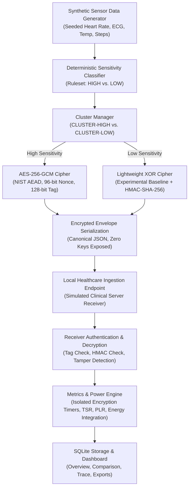

# Cluster-Based IoT Healthcare Data Encryption & Energy Benchmark

An academic research prototype and demonstration platform evaluating **Cluster-Based Sensitivity-Adaptive Encryption** for battery-constrained Internet of Things (IoT) healthcare devices.

The system benchmarks a conventional **uniform AES-256-GCM baseline** against a **proposed adaptive architecture** where critical high-sensitivity vitals use authenticated AES-256-GCM and routine non-critical telemetry routes through an experimental lightweight comparison cipher.

---

## 1. Architecture & Data Flow



---

## 2. Requirements Traceability Matrix

### Functional Requirements (FR)

| Req ID | Requirement Description | Implementation Location | Test Status |
|---|---|---|---|
| **FR-01** | Seeded synthetic healthcare data (HR, ECG, Temp, Steps) | `src/data_generator.py` | `test_generator_reproducibility` (PASSED) |
| **FR-02** | Deterministic configurable sensitivity rules with explanations | `src/classifier.py` | `test_classification_rules` (PASSED) |
| **FR-03** | Deterministic high/low cluster grouping | `src/cluster_manager.py` | `test_cluster_formation` (PASSED) |
| **FR-04** | Complete pipeline visualization in dashboard | `static/index.html`, `static/app.js` | Verified in UI |
| **FR-05** | AES-256-GCM encryption with fresh nonces for HIGH records | `src/crypto.py` | `test_aes256_gcm_roundtrip` (PASSED) |
| **FR-06** | Experimental XOR encryption with HMAC-SHA256 for LOW records | `src/crypto.py` | `test_xor_roundtrip` (PASSED) |
| **FR-07** | Uniform all-AES-256-GCM baseline mode | `src/benchmark_runner.py` | `test_paired_benchmark_execution` (PASSED) |
| **FR-08** | Receiver decryption, integrity verification, and rejection | `src/receiver.py` | `test_receiver_stats_tracking` (PASSED) |
| **FR-09** | Local transmission to simulated healthcare receiver | `src/server.py`, `src/receiver.py` | `test_health_endpoint` (PASSED) |
| **FR-10** | Interactive tamper rejection verification control | `src/crypto.py`, `src/server.py` | `test_tamper_demo_endpoint` (PASSED) |
| **FR-11** | Monotonic high-resolution encryption timing isolation | `src/benchmark_runner.py` | `test_timing_stats` (PASSED) |
| **FR-12** | Authoritative TSR and PLR transmission metrics | `src/metrics.py` | `test_tsr_and_plr_formulas` (PASSED) |
| **FR-13** | Hardware power measurement adapter interface | `src/power_measurement.py` | `test_hardware_adapter_unconnected` (PASSED) |
| **FR-14** | Calibrated external lab instrument CSV power log importer | `src/power_measurement.py` | `test_csv_importer_valid` (PASSED) |
| **FR-15** | Software estimation fallback model with visible parameters | `src/power_measurement.py` | `test_simulation_fallback_provenance` (PASSED) |
| **FR-16** | Trapezoidal electrical energy integration ($E = \int V \times I \, dt$) | `src/metrics.py` | `test_energy_integration_known_signal` (PASSED) |
| **FR-17** | Indicative battery runtime estimation with disclaimers | `src/metrics.py` | `test_indicative_battery_runtime` (PASSED) |
| **FR-18** | Side-by-side baseline vs. adaptive comparison with deltas | `src/benchmark_runner.py` | `test_paired_benchmark_execution` (PASSED) |
| **FR-19** | Configurable batch size and repetition variability | `src/benchmark_runner.py` | `test_repeated_comparison_reproducibility` (PASSED) |
| **FR-20** | CSV and JSON benchmark results export | `src/server.py` | `test_export_endpoints` (PASSED) |
| **FR-21-25** | Accessible dashboard, record trace, security caveats, honest summary | `static/index.html`, `static/app.js` | Verified |

### Non-Functional Requirements (NFR)

- **NFR-01 (Correctness):** Decrypted records match original synthetic data exactly; tamper detection triggers on bit flips.
- **NFR-02 (Security):** NIST AES-256-GCM implementation; keys never logged, stored in browser, or exported; ephemeral in-memory dev keys.
- **NFR-03 (Measurement Honesty):** Prominent provenance badges differentiate `HARDWARE`, `IMPORTED`, and `SIMULATED / ESTIMATED`.
- **NFR-04 (Repeatability):** Identical random seeds produce byte-identical workloads across paired trials.
- **NFR-05 (Reliability):** Zero-denominator safety, robust handling of corrupt packets, missing files, and cancellation requests.
- **NFR-06 (Performance):** Pure crypto execution is strictly isolated from JSON serialization and network transport latency.
- **NFR-07 (Resource Efficiency):** Runs 100% locally on a standard laptop with zero cloud accounts, external databases, or Docker requirements.
- **NFR-08 (Usability):** One-click demo controls, responsive tabs, visual comparative bars, and plain-language summaries.
- **NFR-09 (Privacy):** All data is strictly synthetic; services bind to localhost.
- **NFR-10 (Maintainability):** Modular architecture with clear separation between crypto, classification, metrics, transport, and UI.

---

## 3. Quickstart & Clean Startup Instructions

### Prerequisites
- Python 3.10 or higher (Tested on Python 3.14.5 Windows 64-bit).
- Web browser (Chrome, Edge, Firefox, Safari).

### Setup & Installation
```bash
# Clone or navigate to the repository directory
cd "c:\Cluster based IoT data encryption"

# Install required dependencies
pip install -r requirements.txt
```

### Running the Application Server
```bash
# Start the local FastAPI server and dashboard
python -m uvicorn src.server:app --reload --port 8000
```
Open your browser and navigate to:
**[http://127.0.0.1:8000](http://127.0.0.1:8000)**

### Running the Automated Demo Benchmark Script
To execute a headless paired comparison and generate sample export files:
```bash
python scripts/run_demo_benchmark.py
```
Outputs are written directly to `exports/sample_benchmark_run.csv` and `exports/sample_benchmark_comparison.json`.

### Running the Test Suite
Execute the entire test suite across all 6 phases:
```bash
python -m pytest tests/ -v
```

---

## 4. Test Matrix & Verification Summary

The test suite covers 45 automated unit, integration, and mathematical validation tests across 7 dedicated test modules:

```text
tests/test_phase1_pipeline.py
  - test_generator_reproducibility                     PASSED
  - test_generator_different_seeds                     PASSED
  - test_classification_rules                         PASSED
  - test_cluster_formation                            PASSED

tests/test_phase2_crypto_receiver.py
  - test_key_manager_redaction                         PASSED
  - test_aes256_gcm_roundtrip                          PASSED
  - test_xor_roundtrip                                 PASSED
  - test_aes_tamper_rejection                          PASSED
  - test_xor_tamper_rejection                          PASSED
  - test_nonce_uniqueness                              PASSED
  - test_receiver_stats_tracking                       PASSED

tests/test_phase3_benchmark_engine.py
  - test_tsr_and_plr_formulas                          PASSED
  - test_timing_stats                                  PASSED
  - test_percentage_change_directions                  PASSED
  - test_paired_benchmark_execution                    PASSED
  - test_benchmark_cancellation                        PASSED

tests/test_phase4_battery_subsystem.py
  - test_unit_conversions                              PASSED
  - test_energy_integration_known_signal               PASSED
  - test_indicative_battery_runtime                    PASSED
  - test_csv_importer_valid                            PASSED
  - test_csv_importer_valid_alternate_headers         PASSED
  - test_csv_importer_rejections                       PASSED
  - test_simulation_fallback_provenance                PASSED
  - test_hardware_adapter_unconnected                 PASSED

tests/test_phase5_api_and_exports.py
  - test_health_endpoint                               PASSED
  - test_demo_generate_endpoint                        PASSED
  - test_benchmark_run_and_comparison_endpoints        PASSED
  - test_tamper_demo_endpoint                          PASSED
  - test_power_csv_import_endpoint                     PASSED
  - test_export_endpoints                              PASSED
  - test_index_html_serving                            PASSED

tests/test_phase6_hardening.py
  - test_sqlite_persistence_across_reloads             PASSED
  - test_zero_secret_leakage_audit                     PASSED
  - test_corrupt_envelope_handling                     PASSED
  - test_repeated_comparison_reproducibility           PASSED
  - test_source_label_honesty                          PASSED

tests/test_phase8_audit_and_validation.py
  - test_percentage_change_and_energy_saving_formulas  PASSED
  - test_evaluate_result_status_classification         PASSED
  - test_multi_repetition_aggregate_statistics         PASSED
  - test_unrounded_mathematical_consistency_in_authoritative_comparison PASSED
  - test_warmup_and_ten_measured_repetitions           PASSED
  - test_timing_isolation_and_breakdown                PASSED
  - test_mode_b_physical_power_integration             PASSED
  - test_security_audit_key_sizes_nonces_and_tampering PASSED
  - test_full_pipeline_api_and_export_consistency      PASSED

============================== 45 passed in 1.25s ==============================
```

---

## 5. Security Notice & XOR Disclosures

> [!WARNING]
> **Academic Comparison Boundary:** The lightweight XOR transformation implemented in this project is strictly an **experimental baseline** for measuring computational trade-offs against AES-256-GCM.
> Bitwise XOR alone does **not** provide production-grade confidentiality for healthcare records. If an XOR keystream is reused or predictable, plaintext recovery is trivial. The attached HMAC-SHA-256 provides integrity authentication only; it does not resolve XOR's inherent confidentiality vulnerabilities.
> Production healthcare devices must utilize authenticated AEAD ciphers (e.g. AES-256-GCM or ChaCha20-Poly1305).

---

## 6. Known Hardware Limitations

1. **Hardware Power Meters:** A physical benchtop power meter (Monsoon Power Monitor, Keysight N6705, or Otii Arc) is not attached to this workstation. The application operates in the software estimation fallback mode and provides the CSV importer for laboratory instrument log integration.
2. **Desktop vs. Microcontroller Crypto:** On x86-64 desktop CPUs, AES-256-GCM is accelerated by Intel/AMD AES-NI hardware instructions in native C via OpenSSL. In contrast, the experimental XOR module runs in interpreted Python bytecode. Therefore, desktop benchmarks reflect interpreter loop overhead rather than bare-metal microcontroller CPU cycles.

---

## 7. Additional Documentation

- [ClusterGuard UI Redesign & Faculty Presentation Guide](docs/UI_REDESIGN_AND_DEMO_WALKTHROUGH.md)
- [Phase 8 Performance Audit & Regression Analysis](docs/PERFORMANCE_AUDIT_AND_REGRESSION_ANALYSIS.md)
- [Battery & Energy Measurement Methodology](docs/BATTERY_METHODOLOGY.md)
- [Final-Review Demo Script & Panel FAQ](docs/DEMO_SCRIPT_AND_PANEL_FAQ.md)
- [Phase 0 Inspection & Architecture](docs/PHASE_0_INSPECTION_AND_ARCHITECTURE.md)
- [Original Product Specification](Antigravity_Execution_Plan_IoT_Healthcare_Encryption.md)
